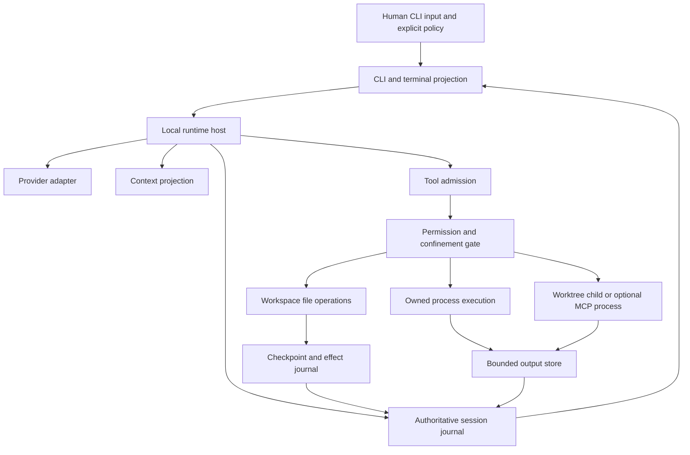

# Architecture and semantic boundaries

This is a proposed implementation contract, not a description of a completed product. Every runtime scenario is **UNRUN**. The [native specification](spec.kvx) owns requirements, tasks and status. The [execution plan](parallel-execution.md) owns the scheduling explanation; its packet records are incorporated directly into the native task table.

## 1. The product boundary

Gideon Code is one local Python CLI process with optional owned child processes. A user starts it in a repository, selects an already configured model, grants a bounded operation policy, and receives changes plus observable command evidence. The same runtime serves headless and interactive consumers. There is no gateway, account server, scheduler, personal knowledge service or hidden background authority.

The old platform remains source material during extraction. Importing it from a new namespace is not extraction. A lean executable that starts a gateway in the background is not standalone execution. A passing test against the old implementation is not evidence for a copied implementation.

The provider connection is a control-plane capability of the host, separately configured from the model's ability to request workspace network access. A sandbox that denies workspace egress must not silently be relaxed just because the host needs its configured model endpoint. The documented adapter must explain where each connection originates and which policy governs it.

## 2. Source seams and replacement decisions

| Retained behaviour | Present source seam | Required change before standalone acceptance |
|---|---|---|
| Streaming turn/tool orchestration | `runtime/gideon/engine/agents/native/runtime.py` | Inject provider, stores, policy, audit, tools and cancellation; remove constructor-time platform providers and MCP-server ownership. |
| Provider protocol/cache/events | `runtime/gideon/integrations/llm/` | Preserve wire semantics; replace registry/config/credential ownership and eager ACP initializer. |
| Read evidence and workspace access | `runtime/gideon/engine/agents/native/read_gate.py`, `workspace_access.py` | Preserve full-content hashes and exact matching; inject workspace/session identity. |
| Conflict-aware tool dispatch | `runtime/gideon/engine/agents/native/dispatch_plan.py` | Keep resource conflict ordering; remove personal-domain resource rules. |
| Coding verbs | `runtime/gideon/engine/agents/native/builtin_tools.py` | Extract handlers and real consumer; no knowledge/inbox/task services; checkpoint errors become refusals. |
| OS confinement and command policy | `runtime/gideon/security/sandbox.py` and shell/path modules | Inject limits, home/cache paths and network policy; preserve honest refusal if required isolation is unavailable. |
| Rewind | `runtime/gideon/engine/turn_checkpoints.py` | Inject storage/project roots and secret classification; preserve external-change conflict checks. |
| Conversation JSONL primitives | `runtime/gideon/engine/session_workspace.py` | Reuse useful encoding/layout primitives; add strict corruption, writer-lock and durable acknowledgement semantics. |
| Compaction | `runtime/gideon/cognition/context_compaction.py` | Retain pairing and reduction algorithm; replace workflow-backed resume accounting with session-local input. |
| Symbol consumer | `runtime/gideon/integrations/tool_providers/code_map.py` and `assurance/codegraph/` | Rehome existing tool with parser/cache roots and source-generation provenance. |

These are source pointers, not an exhaustive keep manifest. The inventory supplies exact symbols, hashes, dependencies and attribution. Source locations can change; the frozen revision remains authoritative for provenance.

## 3. Contract identities

Every packet consumes and produces a named contract at a major version. A new field cannot change the meaning of an existing field without a contract revision. Producers and consumers use the same units and null semantics. There is no implicit coercion of a string to a boolean, missing usage to zero, milliseconds to seconds, a branch name to a tree identity, or a successful transport to a successful effect.

| Contract | Owner boundary | Producer → consumers | Mandatory semantic properties |
|---|---|---|---|
| `GC.Host/1` | Bootstrap host | CLI startup → component consumers | Explicit services, immutable run configuration, no global platform discovery. |
| `GC.Event/1` | Session/runtime | Runtime/store → CLI, terminal, receipts | Unique event ID, session-local contiguous sequence, version, typed payload, durable/public projection distinction. |
| `GC.Provider/1` | Provider adapter | Configured model endpoint → turn loop | Complete/incomplete distinction, tool IDs, nullable usage, cancellation, declared capabilities. |
| `GC.Tool/1` | Tool admission | Parsed tool call → policy, handler, loop | Schema-valid arguments, stable call identity, bounded result, explicit refusal and unknown outcome. |
| `GC.Policy/1` | Permission gate | Human-origin configuration → all effect adapters | Deny precedence, bound approvals, canonical targets, revalidation, no model-created authority. |
| `GC.Workspace/1` | Workspace adapter | Filesystem/Git observation → tools, checkpoints, evaluation | Project/worktree identity, byte/mode hashes, symlink rules, dirty overlay provenance. |
| `GC.Effect/1` | Effect journal | Tool/exec intent → recovery, final reporting | Intent before effect, explicit uncertain outcome, no automatic mutation replay. |
| `GC.Session/1` | Session store | Journal → resume/context/projections | One writer, strict corruption semantics, committed sequence, schema compatibility. |
| `GC.Context/1` | Context assembly | Instructions/history/tool output → provider requests | Mandatory constraints retained, pairing valid, omission/provenance visible. |
| `GC.Checkpoint/1` | Checkpoint store | Mutations → diff/rewind/recovery | Owned pre/postimages, safe retention, conflict refusal, no false multi-file atomicity. |
| `GC.Execution/1` | Process adapter | Approved command → polling/cancel/verifier | Cwd/env identity, process ownership, complete exit evidence or explicit unknown. |
| `GC.Child/1` | Delegation | Parent packet → child/result integration | Bounded authority, immutable submission, source custody, no uncontrolled merge. |
| `GC.Extension/1` | Optional integration | Packaged/MCP/skill discovery → runtime | Discovery cannot grant authority; optional imports isolated; bounded schemas/results. |
| `GC.Inventory/1` | Extraction tooling | Source tree → vectors/package/cutover | Exhaustive exact paths, resolved dependency edges, immutable provenance. |
| `GC.Cutover/1` | Cutover tooling | Manifest + explicit approval → deletion/promotion | Exact digest/source binding, archive recovery, no inferred wildcard deletion. |
| `GC.Evidence/1` | Qualification | Actual command observation → task/wave/release closure | Source/environment/command/log identity, no skip-as-pass, historical receipt preservation. |

Field details and state transitions live in the linked runtime, storage, security, delegation and extraction chapters. If two chapters disagree about a field or transition, the affected packets are blocked until a spec revision reconciles both producers and consumers. Picking the convenient interpretation is prohibited.

## 4. Host registration without shared-file contention

The first runtime packet owns the minimal host interfaces and router. Subsequent concurrent packets own their feature modules, packaged registration descriptors, focused checks and fixtures. They do not all edit the same CLI or agent loop file. The macro integration owner joins their already qualified consumers into the default workflow.

A packaged descriptor is data inside the installed `gideon_code` distribution, not a repository plugin path. It identifies `component_id`, `contract_version`, import module, factory, provided consumer verbs, required capabilities and configuration schema. The loader accepts only the declared in-package namespace and schema version. It never discovers executable components from the current repository, user-controlled Python paths, model text or skill files. Duplicate component/verb identities fail startup with a concrete conflict.

Each vertical packet must expose an actual reachable consumer through the host's bounded inspection/feature entrypoint, then qualify the real output or effect. A descriptor plus an uncalled module is incomplete. A test that directly constructs a class while bypassing configuration, policy or persistence cannot stand in for the declared consumer journey. The default workflow integration owns only the shared assembly files and cannot silently alter packet semantics.

This is a small static composition seam, not a new general plugin framework. Packaged descriptors do not provide arbitrary dynamic dependency injection, repository-defined Python execution, remote marketplace discovery or authority delegation. If the seam grows beyond a small loader and explicit contracts, revise the design before implementation.

## 5. Semantic invariants

| ID | Invariant | Failure disposition |
|---|---|---|
| `INV-01` | Exactly one authoritative writer per session; committed sequence is contiguous. | Refuse second writer or stop on corruption. |
| `INV-02` | A model call cannot execute an incomplete, malformed, duplicate or unauthorized tool call. | Pairing-safe tool error/refusal; no effect. |
| `INV-03` | Every effect is preceded by durable intent and current policy admission. | Stop before effect; recovery required if persistence fails after effect. |
| `INV-04` | A path approval and preimage remain valid at the mutation boundary. | Stale-target refusal; no alternate fuzzy match. |
| `INV-05` | Checkpoint failure blocks a protected edit. | Explicit checkpoint error; no write. |
| `INV-06` | Rewind restores only owned postimages, preserving later external work. | Conflict report; no force restore. |
| `INV-07` | Read-only/plan policy constrains every child, tool, hook and command. | Refusal across all paths. |
| `INV-08` | Unknown provider/process/effect outcome remains unknown until reconciled. | No invented success or blind effect replay. |
| `INV-09` | Bounded display never implies full evidence; raw retrieval is digest-verified. | Explicit truncation/missing-object error. |
| `INV-10` | Compaction cannot remove mandatory task/policy context or break tool pairing. | Rebuild projection or refuse request on insufficient headroom. |
| `INV-11` | A worktree or separate process is not OS isolation. | Qualify the actual enforcement boundary or label unsupported. |
| `INV-12` | Child permissions/budgets cannot exceed or reset parent authority. | Reject packet; stop unauthorized child before work. |
| `INV-13` | A receipt binds actual command/source/config/environment, not task prose. | Stale/incomplete evidence does not close work. |
| `INV-14` | Preserved vectors stay byte-identical; adapters call extracted code. | Extraction blocked; no expected-result edits. |
| `INV-15` | Old platform imports/config/build hooks are absent from active standalone paths. | Artifact boundary fails. |
| `INV-16` | Pruning is authorized only by exact current manifest/source approval. | Stop before first destructive operation. |
| `INV-17` | Unrelated user changes, untracked files and personal state survive. | Overlap conflict blocks cutover/integration. |
| `INV-18` | Optional features do not become core startup dependencies. | Missing selected extra is explicit; unrelated startup remains available. |
| `INV-19` | One unchanged successful packet gate is consumed once by integration. | No confidence reruns or duplicate reviewer campaigns. |
| `INV-20` | Parallel writers have disjoint owned paths or a declared dependency. | Scheduler rejects launch; do not rely on Git conflict detection later. |

The invariants are executable obligations through named acceptance scenarios, not claims of a mathematical proof of the implementation. Static validation detects structural gaps; real negative/fault scenarios test semantics. Neither guarantees the absence of undiscovered defects.

## 6. Parallelism and compatibility rules

Two tasks may overlap only when their complete touched-path sets are disjoint, their dependencies are qualified at the required source revision, and their contract versions agree. A read dependency does not grant write ownership. Shared files, test fixtures, package manifests, lockfiles, generated registries and source interfaces count as shared writes even when two agents expect to edit different lines.

The scheduler reserves a path set before launch and checks it again before accepting a result. A packet discovering an undeclared path records an interface finding and stops that portion; it cannot extend its own scope. The integration owner may version the plan, add the missing dependency and reissue the packet. It may not silently drop the affected acceptance clause.

Contract changes require a delta record naming old/new semantics, producers, consumers, source revisions, migrated persisted data, affected cases and prior receipts invalidated. A new major contract is not accepted while any consumer still expects the old meaning. Additive fields require documented defaults and unknown-field handling; they are not automatically compatible.

Each wave-close task consumes completed packet receipts and runs one distinct cross-boundary journey. It does not rerun every successful packet gate, commission a second review agent, or rebuild a passed packet for reassurance. A new integration candidate whose shared behavior changed has its own declared integrated gate.

## 7. Completion boundary

A packet is implemented when its full declared behavior and consumer exist; it is qualified only after its focused gate returns valid passing evidence. An assembled wave additionally needs every declared packet, one merged consumer journey and resolved semantic findings. The programme additionally needs artifact independence, approved cutover, measured coding capability and honest supported-platform/provider documentation.

No source count, task count, document length, nominal test count, checkpoint existence or model statement substitutes for those outcomes.
